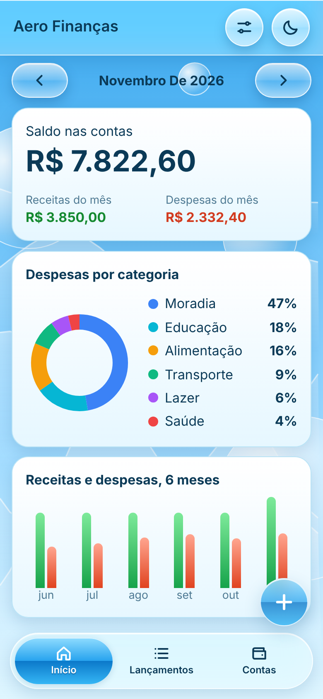
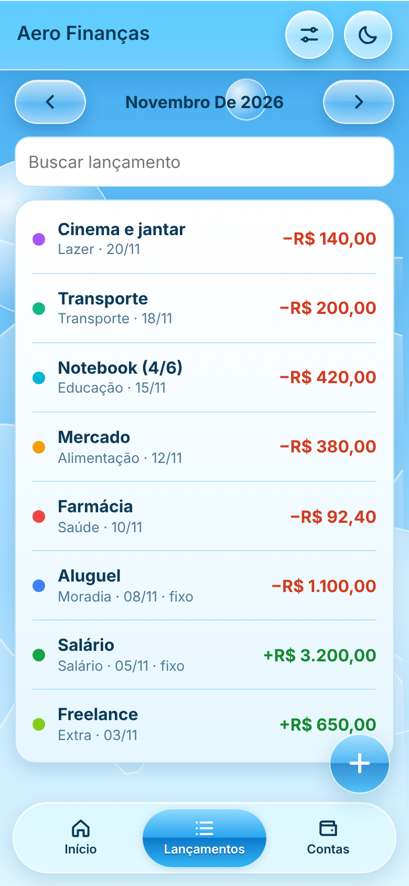
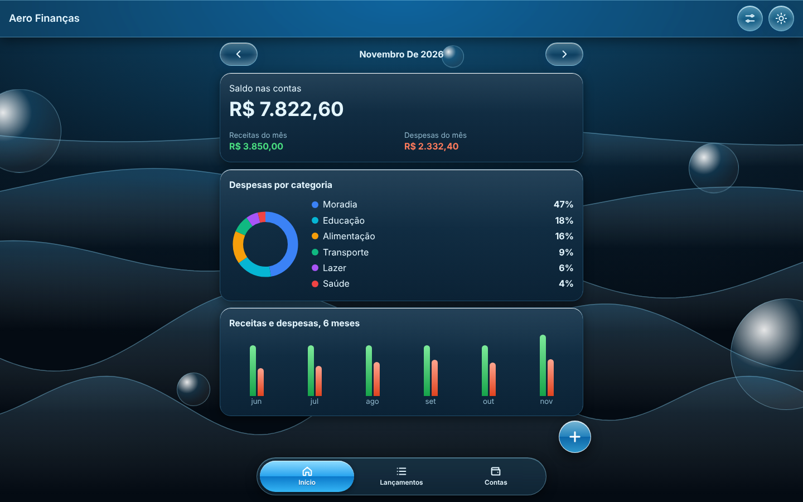

# Aero Finanças

Aplicativo web de controle financeiro pessoal e familiar, com dashboard, lançamentos parcelados e recorrentes, e uma interface inspirada na estética **Frutiger Aero** (vidro, brilho, bolhas e ondas, como nas interfaces dos anos 2000).

Feito com **HTML, CSS e JavaScript puros**, sem frameworks e sem dependências. Os dados ficam salvos no próprio navegador.

**[Ver o app funcionando](https://joyful-cobbler-3b02ea.netlify.app/)**

<p align="center">
  
  
</p>
<p align="center">
  
</p>
## Funcionalidades

**Controle financeiro**
- Lançamentos de receitas e despesas: criar, editar, excluir e buscar, com navegação por mês.
- Várias contas, cada uma com saldo inicial e saldo atual.
- Lançamentos **pendentes** (ainda não efetivados), que não entram no saldo até a data chegar.
- **Parcelamento:** informe o valor total e em quantas vezes, e o app calcula quanto fica por mês. A diferença de centavos vai para a última parcela.
- **Parcela em andamento:** se você já está na 6ª de 12, o app lança as 12 parcelas, cada uma no seu mês.
- **Mesmo valor por alguns meses:** útil para uma renda que vem por 3 meses, por exemplo.
- **Valor fixo todo mês, sem data final:** para salário, aluguel e assinaturas (lança 60 meses de uma vez).
- Exclusão de todas as repetições de um grupo com uma ação.

**Dashboard**
- Saldo acumulado até o fim do mês visto. Em meses futuros, aparece como **saldo previsto**, incluindo parcelas e rendas ainda pendentes.
- Receitas e despesas do mês.
- Gráfico de rosca de despesas por categoria.
- Gráfico de barras de receitas e despesas dos últimos 6 meses.

**Interface**
- Tema claro (padrão) e escuro.
- Vidro (`backdrop-filter`) nas barras e botões, com cards glossy.
- Ondas animadas desenhadas em `<canvas>`, com controle de velocidade, intensidade e opção de desligar.
- Abertura animada ao iniciar, inspirada em aberturas de consoles clássicos.
- Transições entre telas, indicador deslizante nas abas e painéis que sobem e descem.
- Som de fundo em volume baixo, com ajuste de volume e opção de desligar. Pausa sozinho quando o app vai para segundo plano.
- Layout responsivo, pensado primeiro para celular.

**Dados**
- Salvamento automático no `localStorage`.
- Backup: exportar e importar todos os dados em JSON.

## Tecnologias

| Parte | Como foi feito |
| --- | --- |
| Estrutura | HTML semântico, em um único `index.html` |
| Estilo | CSS puro: variáveis para os temas, `backdrop-filter`, gradientes e `@keyframes` |
| Lógica | JavaScript puro (ES6+), sem bibliotecas |
| Gráficos | SVG gerado por código (rosca) e barras em CSS |
| Ondas | Canvas 2D com `requestAnimationFrame` |
| Armazenamento | `localStorage` |
| Ícones | SVG próprios, desenhados em linha (sem emojis nem bibliotecas) |
| Hospedagem | Netlify |

## Estrutura

```
aero-financas/
├── index.html    # estrutura, abertura e elementos fixos
├── style.css     # tema, vidro, animações e layout
├── script.js     # estado, telas, cálculos, ondas, áudio e abertura
├── som.mp3       # música de fundo
└── docs/         # imagens usadas neste README
```

## Como rodar

Não precisa instalar nada.

1. Baixe ou clone o repositório.
2. Abra o `index.html` no navegador.

Se preferir um servidor local, use a extensão **Live Server** do Visual Studio Code.

> Os navegadores bloqueiam som automático. A música começa no primeiro toque ou clique na tela.

## Como publicar

Em hospedagens estáticas como Netlify, GitHub Pages ou Vercel, basta publicar a pasta com os quatro arquivos. No Netlify, dá para arrastar a pasta (ou um zip com o `index.html` na raiz) para o [Netlify Drop](https://app.netlify.com/drop).

## Decisões de projeto

- **Sem framework:** o objetivo era mostrar domínio de HTML, CSS e JavaScript, e manter o app leve e fácil de hospedar.
- **Saldo por mês:** o saldo é calculado somando o saldo inicial das contas e todos os lançamentos até o fim do mês visto. Em meses futuros, entram também os pendentes, para dar uma previsão.
- **Parcelas como lançamentos independentes:** cada parcela é um lançamento com um identificador de grupo. Isso permite editar uma parcela sozinha e excluir o grupo inteiro.
- **Desempenho:** as animações usam só `transform` e `opacity`. As ondas pausam quando a aba fica escondida, e a resolução do canvas é limitada.
- **Segurança:** todo texto digitado pelo usuário é escapado antes de ir para a tela.
- **Acessibilidade:** botões de ícone têm `aria-label`, e as animações podem ser desligadas nos Ajustes.

## Limitações conhecidas

- Os dados ficam em **um navegador de um aparelho**. Não há sincronização entre dispositivos. Limpar os dados do navegador apaga tudo, então use o backup em JSON.
- O valor fixo mensal lança 60 meses (5 anos) de uma vez.
- Não há login nem criptografia dos dados.

## Próximos passos

- [ ] Sincronização entre aparelhos, com backend (Firebase ou Supabase) e login.
- [ ] Metas e orçamento por categoria.
- [ ] Categorias personalizadas.
- [ ] Transferência entre contas.
- [ ] Instalação como app (PWA) e uso offline.

## Créditos

- Música de fundo: "ocean bubbles frutiger aqua", de 9jackjack8.
- Inspiração visual: estética Frutiger Aero e a interface XMB do PSP.
